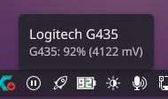

# g435-tray

🇬🇧 [English](README.md) · 🇮🇹 Italiano

Icona nella tray con la batteria della cuffia **Logitech G435** tramite il dongle LIGHTSPEED.
È scritta in Rust e gira su **Linux** (KDE in modo nativo, GNOME con l'estensione AppIndicator) e su **Windows**.

- L'icona mostra la percentuale ed è colorata in base al livello: verde, arancione (≤35%) o rosso (≤15%).
- Il tooltip mostra `G435: 94% (4140 mV)`.
- Menu: *Aggiorna ora*, *Avvio automatico*, un promemoria delle combinazioni di tasti della cuffia, *Esci*.
- Su Linux fa funzionare il tasto Volume + della cuffia (vedi [Tasti della cuffia](#tasti-della-cuffia-linux)).
- Legge la batteria ogni 15 minuti e, in caso di errore, riprova ogni minuto.
- Su Linux le letture automatiche aspettano che la cuffia non stia riproducendo audio, per al massimo 30 minuti; nel frattempo l'icona mostra l'ultimo valore letto. La prima lettura all'avvio e *Aggiorna ora* leggono subito. Un gioco o un browser con l'audio aperto contano come "in uso" anche quando sono in silenzio.
- Non usa G HUB né DLL Logitech e non fa traffico di rete.



> Progetto non ufficiale e non affiliato a Logitech.

## Dongle supportati

| PID | Revisione | Trasporto | Stato |
|-----|-----------|-----------|-------|
| `046d:0acb` | HDT647 (la più diffusa) | feature report 6 tramite il bridge Realtek ("bootloader") | **testato** |
| `046d:0adf` | revisione più recente | report da 64 byte con CRC-16 | porting da [portyporty][porty], non testato |

Per sapere quale revisione hai: `lsusb | grep 046d` su Linux, oppure Gestione dispositivi su Windows.

## Installazione

**Arch Linux (AUR)**: ci sono due pacchetti, scegline uno:

- [logitech-g435-battery-bin](https://aur.archlinux.org/packages/logitech-g435-battery-bin): binario già compilato, si installa in pochi secondi.
- [logitech-g435-battery](https://aur.archlinux.org/packages/logitech-g435-battery): compilato sul tuo PC.

```bash
yay -S logitech-g435-battery-bin
```

Entrambi installano anche la regola udev e una voce nel menu delle applicazioni. Avvia **G435 Tray** dal menu, poi attiva *Avvio automatico* dal menu dell'icona.

**Altre distribuzioni Linux**: scarica `g435-tray-<versione>-x86_64-linux.tar.gz` dall'[ultima release](https://github.com/deddroid/logitech-g435-battery/releases/latest), estrailo e avvia `g435-tray`. Se ottieni un errore di permessi, installa la regola udev inclusa (vedi [Permessi](#permessi-linux)).

**Windows**: scarica `g435-tray-<versione>-x86_64-windows.zip` dall'[ultima release](https://github.com/deddroid/logitech-g435-battery/releases/latest), estrailo e avvia `g435-tray.exe`. La versione Windows viene compilata e testata automaticamente, ma non è ancora stata provata su un PC Windows reale: ogni segnalazione è benvenuta.

Ogni release contiene anche il file `SHA256SUMS` per verificare i download.

## Compilazione

```bash
cargo build --release
```

L'eseguibile viene creato in `target/release/g435-tray` (su Windows `g435-tray.exe`).

- **Linux**: servono `libudev` (pacchetto `systemd-libs` / `libudev-dev`), ALSA (`alsa-lib` / `libasound2-dev`) e `pkg-config`.
- **Windows**: basta la toolchain Rust MSVC. hidapi usa il backend Rust nativo, quindi non serve un compilatore C.

Per installarlo per l'utente corrente (in `~/.cargo/bin`):

```bash
cargo install --path .
```

## Permessi (Linux)

Il programma deve poter aprire `/dev/hidrawN` del dongle. Se `g435-tray --once` risponde con un errore di permessi:

```bash
sudo cp packaging/linux/70-logitech-g435.rules /etc/udev/rules.d/
```

```bash
sudo udevadm control --reload && sudo udevadm trigger
```

## Uso

```text
g435-tray                 avvia l'icona nella tray
g435-tray --once          stampa "94% (4140 mV)" ed esce (utile per script/waybar/polybar)
g435-tray --interval 30   legge ogni 30 minuti
G435_DEBUG=1 g435-tray --once   mostra il traffico HID
```

## Note e limiti

- **La percentuale è una stima** ricavata dalla tensione della batteria Li-Po (4,2 V = 100%, 3,4 V = 0%). Durante la ricarica la tensione sale e la stima risulta più alta del reale.
- Sul `0acb` ogni lettura mette per un attimo il bridge USB in modalità "bootloader" e **l'audio si interrompe per circa un secondo**. Per questo il programma legge solo ogni 15 minuti e, su Linux, aspetta che l'audio sia fermo: controlla `/proc/asound/cardN/pcm*/sub*/status` della scheda USB della G435, e PipeWire chiude il dispositivo pochi secondi dopo la fine della riproduzione. Su Windows questo controllo non è ancora implementato.
- Il comando di batteria raggiunge la cuffia solo se il dongle è in *remote mode* 1. Se non lo è, il programma lo imposta (è lo stesso valore che usa il tool ufficiale di pairing).
- Se il dongle smette di rispondere (risponde agli ACK ma non restituisce dati), basta staccarlo e riattaccarlo.

## Tasti della cuffia (Linux)

Verificato catturando gli eventi di input e il traffico USB grezzo del dongle con `usbmon`:

| Tasto | Arriva al PC? | Risultato su Linux |
|---|---|---|
| Volume − | sì, HID `KEY_VOLUMEDOWN` | abbassa il volume di sistema |
| Volume + | sì, HID `KEY_VOLUMEUP`, **solo se il volume USB del dongle è sotto il 100%** | alza il volume di sistema |
| Mute | **no**: nessun traffico USB, il microfono viene silenziato dentro la cuffia | l'icona del microfono di sistema non può seguirlo |
| Power, combinazioni | no | gestiti dentro la cuffia |

- **Volume + non fa niente (doppio bip)**: il dongle lo scarta quando il suo volume hardware è al massimo, come se il PC fosse già al 100%. PipeWire lascia sempre quel controllo al 100% e regola il volume via software. L'app lo tiene un gradino sotto il massimo (174/175, −0,4 dB, impercettibile), così Volume + funziona. A mano: `amixer -c <scheda> cset name='G435 Wireless Gaming Headset Playback Volum' 174`.
- **Tasti volume ignorati su KDE Plasma**: KDE elenca il dispositivo "Consumer Control" del dongle come mouse in *Impostazioni di sistema → Mouse e touchpad*; se lì viene disattivato, i tasti volume smettono di funzionare. Riattivalo da lì, oppure metti `Enabled=true` nella sezione `[Libinput][1133][2763][Logitech G series G435 Wireless Gaming Headset Consumer Control]` di `~/.config/kcminputrc`.
- La cuffia non ha tasto play, ANC o modalità trasparenza; la cosa più simile è il sidetone, che ti fa sentire la tua voce attraverso il microfono. Sidetone, limite di volume 85/100 dB e passaggio LIGHTSPEED/Bluetooth si usano solo con le combinazioni di tasti: il menu dell'icona le elenca sotto *Comandi della cuffia*.

## Come funziona (protocollo)

Entrambi i dongle parlano con lo stesso SoC audio (Airoha/Audiowise) usando comandi `"PA"`:

```text
50 41 <categoria> <seq> <len> <comando...>     richiesta
50 49 ...                                      risposta
```

| Comando | Byte | Risposta |
|---|---|---|
| REMOTE_GET_CONNECT_STATUS | `0e .. 01 e3` | `02 00 e3 <0/1>` |
| REMOTE_GET_MODE / SET_MODE | `0e .. 01 e0` / `0e .. 02 e1 01` | `02 00 e0 <mode>` |
| GET_BATTERY | `06 .. 01 00 31` | `07 00 06 <seq\|80> 00 <mV lo> <mV hi> ..` |

Sul `0acb` il trasporto è: entra nel bootloader con il feature report `06 01 03`, invia il comando con `06 04 03 <len> <cmd>` (ack `06 5a` sull'endpoint input), legge la risposta con GET_FEATURE sul report 6 ed esce con `06 08 03`.

## Altre funzioni trovate (non ancora implementate)

Oltre alla batteria, la ricerca disponibile ha documentato questi comandi:

- **Stato di connessione della cuffia** (accesa/spenta): funziona e il programma lo usa già per mostrare "cuffia spenta".
- **RSSI / qualità del link radio** (`GET_RSSI`, `LQ_GET_QUALTY`): sono comandi candidati per un indicatore di segnale. Non sono verificati: durante i test il dongle si è bloccato subito dopo un `GET_RSSI` e un `OTA_CMD_ECHO`.
- **Versione firmware** (`OTA_CMD_GET_IMAGE_VERSION`).
- **LED** (`CMD_SET_LED`, `CMD_SET_LED_PWM`) e **EQ/DSP** (`EQ_ON_OFF`, `DSP_CMD_IIR_EQ`, ...): esistono nel firmware condiviso tra più prodotti, ma non è detto che abbiano effetto sulla G435.
- **Pairing dongle ↔ cuffia** (scan e connect via MAC): è quello che fa il tool ufficiale di ri-associazione.
- Comandi **pericolosi** da non usare: OTA/flash/NVDS (`ERASE_LOAD_REGION`, `OTA_CMD_UPDATE`, `AW_HA_CLEAR_NVDS`, ...).

Nessuno ha ancora trovato comandi per il sidetone, il limite di volume, la lettura del mute hardware o lo stato di ricarica. Il mute e le combinazioni di tasti non generano alcun traffico USB (verificato con `usbmon`).
Il volume e il mute che mostrano altri progetti (es. G435-Companion) sono quelli del sistema operativo, non della cuffia.

## Crediti

- **[deddroid](https://github.com/deddroid)**: idea, test sull'hardware reale e scelte di progetto.
- **Claude (Anthropic)**: ha scritto il codice in Rust, analizzato i progetti esistenti e verificato il protocollo sul dongle `0acb`, il tutto in una sessione di [Claude Code](https://claude.com/claude-code).
- **endes** per il reverse engineering del dongle `0acb`, **portyporty** (Oğuz Kayra Bozkurt) per il protocollo del dongle `0adf`: vedi le fonti qui sotto.

## Licenza

[MIT](LICENSE): chiunque può usare, modificare e redistribuire il codice, anche per scopi commerciali, a patto di mantenere il file della licenza. Le parti derivate da altri progetti sono indicate in [THIRD-PARTY-NOTICES](THIRD-PARTY-NOTICES).

## Fonti

- [endes — "USB HID down the rabbit hole: Logitech G435 dongle"](https://dev.to/endes/usb-hid-down-the-rabbit-hole-logitech-g435-dongle-33if) e il [gist con i comandi](https://gist.github.com/endes0/21193c55e2e38c9b3e3a95492380059c)
- [portyporty/g435-battery-percentage][porty]: tray per Windows, dongle `0adf`, curva tensione→percentuale
- [GotardoN1/G435-Companion](https://github.com/GotardoN1/G435-Companion): batteria via Bluetooth tramite le proprietà PnP di Windows
- [CSaratakij/G435BatteryApproximate](https://github.com/CSaratakij/G435BatteryApproximate): stima basata sul tempo d'uso, nessuna lettura reale

[porty]: https://github.com/portyporty/g435-battery-percentage
